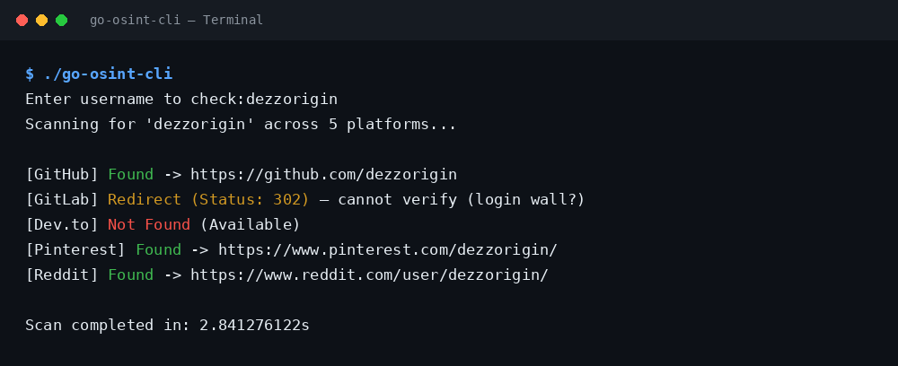
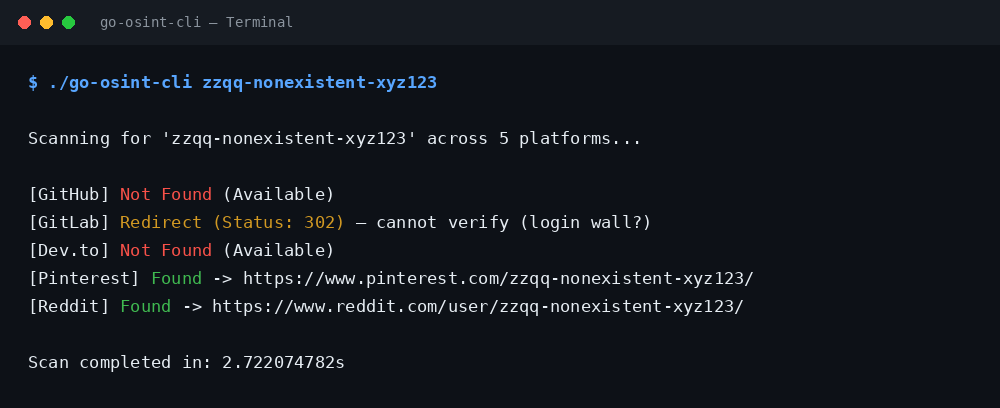
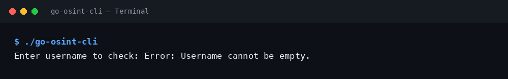

# go-osint-cli

[](https://github.com/dezzorigin/go-osint-cli/actions/workflows/ci.yml)
[](https://go.dev)
[](./LICENSE)

CLI Go kecil untuk mengecek apakah sebuah username sudah dipakai di **GitHub, GitLab, Dev.to, Pinterest, dan Reddit** — sekali jalan, paralel, hasilnya berurutan dan jujur.

🌐 **Live landing:** https://go-osint-cli.pages.dev

## Cara pakai

```bash
# username sebagai argumen
./go-osint-cli dezzorigin

# atau interaktif — program bertanya dulu
./go-osint-cli
Enter username to check: dezzorigin
```

Contoh keluaran asli (username `dezzorigin`):

```
Scanning for 'dezzorigin' across 5 platforms...

[GitHub] Found -> https://github.com/dezzorigin
[GitLab] Redirect (Status: 302) — cannot verify (login wall?)
[Dev.to] Not Found (Available)
[Pinterest] Found -> https://www.pinterest.com/dezzorigin/
[Reddit] Found -> https://www.reddit.com/user/dezzorigin/

Scan completed in: 2.841276122s
```







## Video demo

Demo direkam dari sesi terminal asli (tanpa suara, 9 detik): jalankan `./go-osint-cli`, ketik `dezzorigin`, lihat hasilnya.

[](docs/demo/demo.mp4)

> GitHub tidak menampilkan tag `<video>` di README, jadi video di atas berupa thumbnail yang bisa diklik. File videonya: [`docs/demo/demo.mp4`](docs/demo/demo.mp4).

## Install

Butuh **Go 1.26** atau lebih baru. Tidak ada dependensi di luar standard library.

```bash
# dari source
git clone https://github.com/dezzorigin/go-osint-cli.git
cd go-osint-cli
go build -o go-osint-cli .

# atau langsung dari Go
go install github.com/dezzorigin/go-osint-cli@latest
```

## Cara kerja

1. Program meminta username (argumen `go-osint-cli <username>` atau prompt interaktif).
2. Untuk tiap platform, program meminta URL profil (`https://github.com/<user>` dan seterusnya) secara **paralel** — timeout 10 detik per platform, dengan header `User-Agent` yang mengidentifikasi tool ini.
3. Kode status HTTP diterjemahkan jadi hasil:

   | Status | Arti |
   |---|---|
   | `200` | **Found** — profil merespons di URL itu |
   | `404` | **Not Found (Available)** — username belum dipakai di sana |
   | `3xx` | **Redirect — cannot verify** — platform mengarahkan (biasanya ke halaman login), jadi tidak bisa diverifikasi dari permintaan anonim |
   | lainnya | **Unexpected Response** — status di luar perkiraan |

4. Hasil dicetak dalam **urutan platform yang tetap** (GitHub, GitLab, Dev.to, Pinterest, Reddit), lalu total durasi scan.

Detail arsitektur dan diagram alur: [`docs/architecture.md`](docs/architecture.md) · [diagram alur](docs/diagrams/flow.svg).

## Batasan — dibaca dulu

Tool ini membaca **kode status HTTP saja**, jadi hasilnya heuristik, bukan bukti:

- **Reddit dan Pinterest mengembalikan `200` untuk username apa pun** — “Found” di sana artinya halaman profilnya merespons, bukan bukti akunnya benar-benar ada.
- **GitLab mengarahkan semua permintaan anonim ke halaman login** (`302`), jadi hasilnya selalu “cannot verify” kalau tidak login.
- Username yang tidak ada di satu platform belum tentu bisa didaftarkan (bisa jadi diblokir, dicadangkan, atau melanggar aturan platform).

Jangan jadikan output tool ini satu-satunya bukti. Pakai untuk triase awal, lalu verifikasi manual di platformnya.

## Development

```bash
go test ./...   # unit test (format hasil + daftar platform)
go vet ./...    # static check
gofmt -l .      # harus kosong — semua file terformat
go build -o go-osint-cli .
```

CI (`.github/workflows/ci.yml`) menjalankan `gofmt` + `go vet` + `go test` + `go build` di setiap push dan pull request ke `main`.

## Lisensi

MIT — lihat [LICENSE](./LICENSE).
